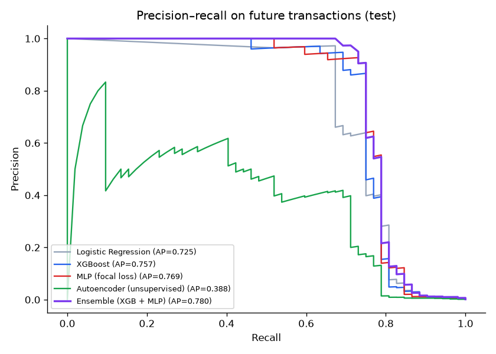
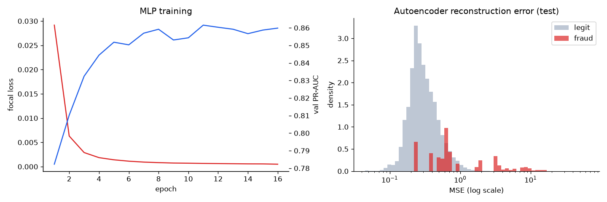

# Credit-Card Fraud Detection — Deep Learning vs Gradient Boosting vs Anomaly Detection


 

A rigorous benchmark of four approaches to detecting fraud in **284,807 real card transactions
(0.17% fraud)**, evaluated the way a bank would actually deploy them: **trained on the past,
tested on the future**, and judged on **what an analyst team can review**.

| Approach | Idea |
|---|---|
| Logistic Regression | Linear, class-weighted baseline |
| XGBoost | Gradient-boosted trees, early stopping on validation PR-AUC |
| **MLP + Focal Loss** (PyTorch) | Deep net; focal loss focuses training on rare, hard fraud cases |
| **Autoencoder** (PyTorch) | Unsupervised — trained on legitimate transactions only; fraud = high reconstruction error |
| Ensemble | Rank-average of XGBoost + MLP |

## Results — held-out *future* transactions (42,722 txns, 52 frauds)

| Model | Test PR-AUC | 95% bootstrap CI | ROC-AUC | Precision @ 0.2% alerts | Recall @ 0.2% alerts |
|---|---|---|---|---|---|
| Logistic Regression | 0.725 | [0.597, 0.835] | 0.977 | 45.9% | 75.0% |
| XGBoost | 0.764 | [0.646, 0.861] | 0.978 | 45.9% | 75.0% |
| MLP (focal loss) | 0.769 | [0.650, 0.870] | 0.981 | 48.2% | 78.8% |
| Autoencoder (unsupervised) | 0.388 | [0.274, 0.535] | 0.945 | 41.2% | 67.3% |
| **Ensemble (XGB + MLP)** | **0.776** | [0.661, 0.875] | **0.985** | **48.2%** | **78.8%** |

**"@ 0.2% alerts"** = if analysts can review the riskiest 2 in every 1,000 transactions (~85 alerts here),
the ensemble catches **~79% of all fraud**, and nearly half of all alerts are real fraud.



### Key findings
1. **Deep learning matches gradient boosting** on tabular data once you use the right loss —
   focal loss + early stopping on PR-AUC — and the two are complementary: the **ensemble is best**.
2. **ROC-AUC is misleading here.** Every model scores > 0.94, yet PR-AUC ranges from 0.39 to 0.78.
   With 0.17% positives, PR-AUC and precision-at-budget are the metrics that matter.
3. **Uncertainty is large.** With only 52 test frauds the 95% CIs overlap heavily — differences between
   the top three models are *not* statistically conclusive. Reporting this is part of doing it right.
4. **Unsupervised detection is a useful fallback, not a replacement.** The autoencoder never sees a
   fraud label yet still catches 67% of fraud at the same alert budget — valuable for new fraud
   patterns or when labels arrive late.



## Methodology choices
- **Temporal split (70/15/15 by `Time`)** — no shuffling, so no future leakage; scaler fit on train only.
- **Model selection on a separate validation window**, final numbers reported once on test.
- **Features:** PCA components V1–V28, `log(1+Amount)`, and cyclical hour-of-day encoding (sin/cos).
- **Focal loss** (α = 0.75, γ = 2) instead of resampling — no synthetic fraud rows, no distortion of the data.
- **Business metric:** precision/recall/£-value at a fixed analyst capacity, not an arbitrary 0.5 threshold.
- **Bootstrap confidence intervals** (500 resamples) on test PR-AUC.

## Run it

```bash
make install   # CPU PyTorch is fine — full run takes ~1-2 minutes
make run       # downloads data, trains all models, writes reports/
make test      # 7 unit tests (focal loss maths, leakage checks, model sanity)
```

## Structure
```
src/fraud/
├── data.py         # download, feature engineering, temporal split
├── nets.py         # FocalLoss, FraudMLP, AutoEncoder, training loops with early stopping
└── experiment.py   # benchmark, bootstrap CIs, alert-budget metrics, figures
tests/test_fraud.py
reports/            # results tables, figures, training history
```

## Data
[Credit Card Fraud Detection](https://www.kaggle.com/datasets/mlg-ulb/creditcardfraud) (ULB Machine
Learning Group) — European cardholders, September 2013. Features V1–V28 are PCA-anonymised.
